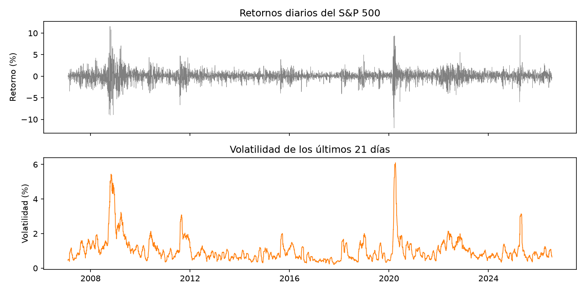
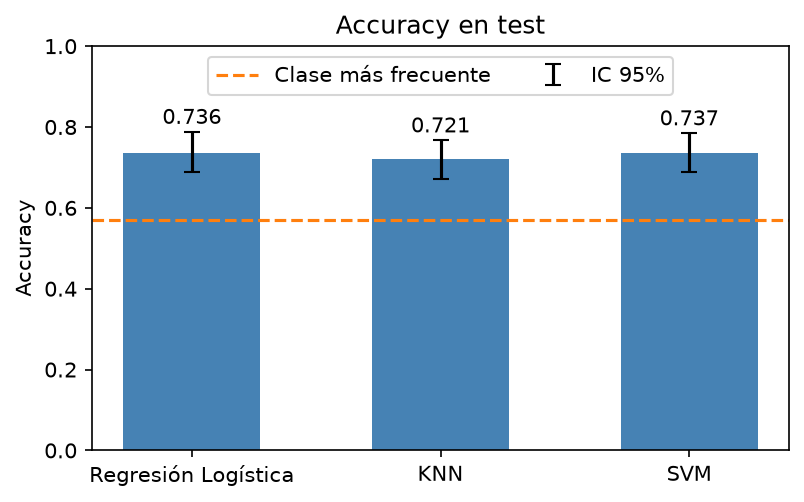

# S&P 500 Volatility Classification

The goal is to predict whether the S&P 500 will have
high or low volatility over the next 5 trading days, using only the information available
at today's close.

## Stack

`Python` · `Pandas` · `NumPy` · `Scikit-learn` · `Statsmodels` · `Matplotlib` · `Seaborn` · `yfinance`

## Problem

Predicting the price or its direction is very hard, but volatility behaves differently: periods
with large moves tend to last for weeks, and so do calm periods. That persistence (volatility
clustering) is what makes it possible to anticipate it.



**Objective:**
- Build the features and the label without using information from the future.
- Split the data in a way that respects the time order.
- Compare logistic regression, KNN and SVM, and interpret the results.

## Data

Daily ^GSPC quotes from January 2007 to July 2026, downloaded from Yahoo Finance with
yfinance: 4,922 trading days, 4,896 usable after dropping the rows left incomplete by the
rolling windows. The download is frozen in `data/sp500_2007_2026.csv`. And the features are: Adj Close, Close, High,
Low, Open y Volume. And the following were constructed based on them

| Feature | Description |
|---|---|
| `retorno` | Daily return |
| `volatilidad_5` | Std of daily returns over the last 5 days |
| `volatilidad_21` | Same, over the last 21 days |
| `retorno_5` | Return over the last 5 days |
| `rango_5` | Average of (high − low) / close over the last 5 days |
| `volumen_relativo` | Daily volume divided by its 21-day average |

**Label:** y = 1 if the std of the returns over the next 5 days is above the median of
`volatilidad_5` in the training period (0.00757), y = 0 otherwise. The classes end up nearly
balanced (51.8% / 48.2%).

## Pipeline

`Raw Data` &rarr; `Feature Engineering` &rarr; `Cleaning` &rarr; `EDA` &rarr; `Time-based Split` &rarr; `Scaling` &rarr; `Models` &rarr; `Evaluation`

1. **Split by date** — train: Feb 2007 to Dec 23, 2021 (3,751 days); test: Jan 2022 to Jul 2026 (1,140 days)
2. **Scaling** — StandardScaler fitted on the training set only
3. **Cross-validation** — TimeSeriesSplit with 5 folds and gap=5
4. **Models** — Logistic Regression (C=0.1), KNN (k=55), SVM (RBF, C=0.1, gamma="scale"), hyperparameters set by hand
5. **Evaluation** — accuracy, precision, recall, F1, confusion matrices, block bootstrap confidence intervals, McNemar's test and decision threshold tuning

## Model Results

Test set of 1,140 days. Baseline (always predicting the most frequent class, high volatility): **0.569**.

| Model | CV accuracy | Test accuracy | 95% CI | Precision | Recall | F1 |
|---|---|---|---|---|---|---|
| Logistic Regression | 0.7363 | 0.7360 | [0.688, 0.788] | 0.8258 | 0.6795 | 0.7456 |
| KNN | 0.7402 | 0.7211 | [0.671, 0.767] | 0.8239 | 0.6487 | 0.7259 |
| SVM | 0.6890 | 0.7368 | [0.689, 0.784] | 0.8262 | 0.6810 | 0.7466 |



- All three models beat the baseline by about 16 points (McNemar, p < 0.0001).
- There is no significant difference between them (p > 0.05). Logistic regression and SVM
  disagree on 71 days, but split them 35 to 36. The features seem to matter more than the
  algorithm.
- The most important features are `rango_5` (1.885) and `volatilidad_21` (0.947), while
  `volumen_relativo` adds nothing.
- The main error is missing high-volatility days (false negatives), which is the costly one.
  Lowering the decision threshold of the logistic regression to 0.43, chosen with the training
  CV only, raises recall from 0.68 to 0.74 without losing accuracy:

| Logistic Regression | Threshold 0.50 | Threshold 0.43 |
|---|---|---|
| Accuracy | 0.7360 | 0.7386 |
| Recall | 0.6795 | 0.7442 |
| False negatives | 208 | 166 |
| False positives | 93 | 132 |

## Notable Technical Decisions

**Avoiding data leakage:** the label threshold and the scaler are computed with the training
set only. There is a 5-day gap between train and test, and inside the cross-validation, because
each label is built with the next 5 days. The decision threshold is chosen with the out-of-fold
probabilities of the training CV, never looking at the test set.

**Block bootstrap:** consecutive days are not independent, so the confidence intervals resample
blocks of 21 days instead of single days.

**Baseline measured on test:** the test period was more volatile than the training one (56.9% vs
50.2% high-volatility days), so the baseline is computed where the models are evaluated.

## Limitations and Future Work

- Only one index, a test period of about four and a half years, and daily data.
- The model says whether volatility will be high or low, not how high.
- Hyperparameters were set by hand. A systematic search with the same CV is the next step.
- McNemar's test assumes independent days, so its p-values are somewhat optimistic.
- Future work: other indices, adding the VIX as a feature, and ensemble models such as Random Forest.

## Run Locally

```bash
git clone https://github.com/JIM1425/sp500-volatility-classification
cd sp500-volatility-classification
pip install -r requirements.txt
```

Open `volatilidad_sp500.ipynb` and run all the cells. It reads the frozen CSV in `data/`, so it
doesn't need an internet connection. The code and the notebook comments are in Spanish.

## Report

The full report is in [`docs/Proyecto_final_Eduardo_Jimenez.pdf`](docs/Proyecto_final_Eduardo_Jimenez.pdf).

## References

- S. Choi et al., "A machine learning approach to predict the S&P 500 absolute percent change," *Discover Artificial Intelligence*, 2024.
- J. D. Díaz, E. Hansen and G. Cabrera, "Machine-learning stock market volatility: Predictability, drivers, and economic value," *International Review of Financial Analysis*, vol. 94, 2024.
- F. Pedregosa et al., "Scikit-learn: Machine learning in Python," *Journal of Machine Learning Research*, vol. 12, pp. 2825–2830, 2011.
- Q. McNemar, "Note on the sampling error of the difference between correlated proportions or percentages," *Psychometrika*, vol. 12, no. 2, pp. 153–157, 1947.
- H. R. Künsch, "The jackknife and the bootstrap for general stationary observations," *The Annals of Statistics*, vol. 17, no. 3, pp. 1217–1241, 1989.
- R. Aroussi, yfinance, https://github.com/ranaroussi/yfinance
